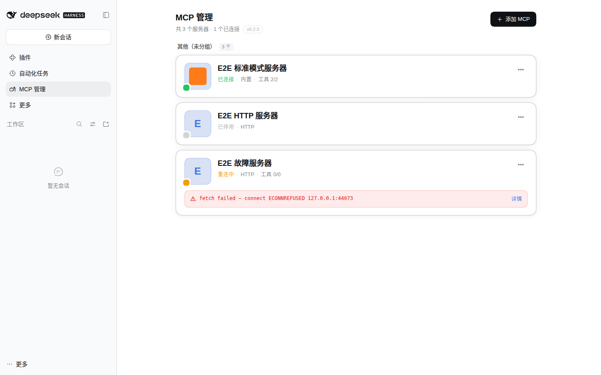
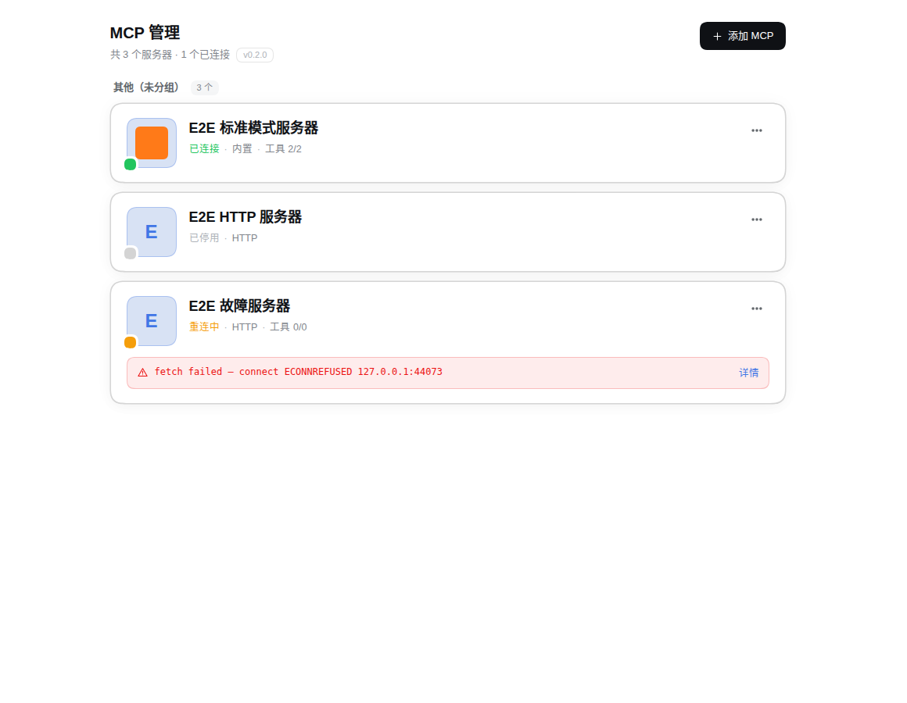
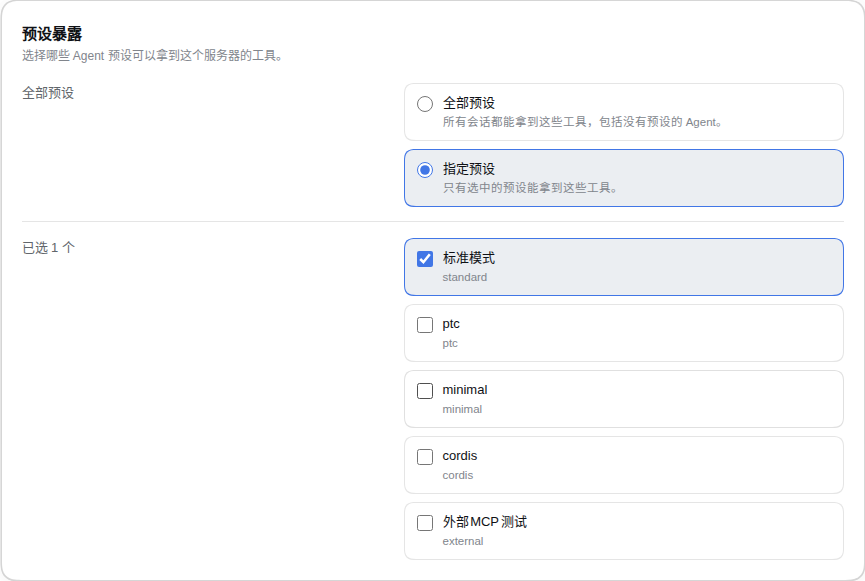
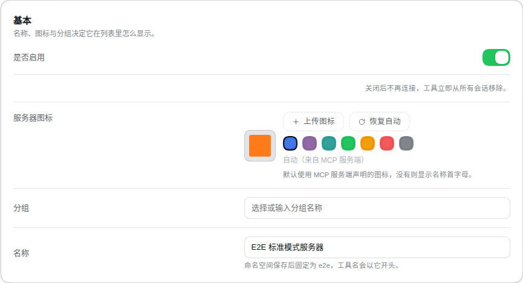

# MCP Manager for DeepSeek Harness

**MCP 管理 / MCP Manager** — manage MCP servers from the DeepSeek Harness Web GUI, and decide
per agent preset whose tools each server hands out.

<p align="center">
  
</p>

<p>
  <a href="LICENSE"></a>
  <a href="README.zh-CN.md">中文</a>
</p>

---

## What it is

DSH can already use tools from external MCP servers, configured as YAML rows in a profile. This
plugin turns that into a page: a sidebar entry **MCP 管理** (directly below **自动化任务**) opens a
full-page manager where you add, edit, group, enable, test and delete MCP servers, and can see for
each one whether it is connected, which transport it uses, how many tools it offers, and why it
failed when it did.

The part that is not just a form: **each server chooses which agent presets receive its tools**.
A database MCP server can be given to a backend preset, a browser server to a research preset, and
nothing at all to presets that should not have them — without editing preset YAML, and the change
applies to live agents as soon as you save.

## Features

- **Full-page manager** in the sidebar, directly below 自动化任务. Rounded cards, iOS-like toggles
  and segmented controls, light and dark themes.
- **CRUD + enable/disable** for MCP servers. A disabled server keeps its settings and status, and
  can be re-enabled in one click.
- **Three transports**: HTTP (Streamable HTTP), SSE, and 内置 / stdio (a local command).
- **Custom headers** for HTTP/SSE, and **OAuth**: Disabled, a static Bearer token, or Client
  credentials.
- **Icons and groups**: a card shows the icon its MCP server declares, falls back to the name's
  first letter, or uses your own uploaded PNG/JPEG/WebP/GIF (≤512 KiB) — there is no built-in emoji
  palette. Ungrouped servers are shown last as 其他（未分组）.
- **Live status**: Connected / Connecting / Retrying / Connection failed / Disabled, tool count, last
  error with a 详情 dialog containing the full message and detail.
- **Per-server preset exposure**: 全部预设 or 指定预设 with checkboxes for the presets the Host
  offers.
- **Test connection** on an unsaved draft before saving it.
- **Per-server tool timeout**, default 60 seconds.

<p align="center">
  
</p>

## Install

The plugin is a DSH bundle. Install it into the Web profile:

```bash
dsh plugin --profile web add @ds-hu/dsh-better-mcp-manager
```

Or use the Web GUI's Plugin Manager (Plugins page → install a bundle), or let an agent install it
with `plugin_manager` (`action: install_bundle`). Reload the Web page; with HMR off, restart the
DSH Web process. Requirements: DSH 0.2.x with the Web profile, Node.js ≥ 20.19.

After install, **MCP 管理** appears in the sidebar directly below **自动化任务**. The page is
global — it is the same server list for every session (and every profile sharing this `$DSH_HOME`).

## Quick start

### 1. Add an HTTP MCP server

Press **+ 添加 MCP**, keep 传输类型 on **HTTP**, and fill in:

- **名称** — anything you recognise, e.g. `Docs search`;
- **服务器图标** — leave **自动（来自 MCP 服务端）**, or use **上传图标** / **恢复自动**
  (see [Icons](#icons));
- **服务器地址** — the MCP endpoint, e.g. `https://mcp.example.com/mcp`;
- **自定义请求头** — add `Authorization` / `Bearer …` if the server needs it, or use **OAuth 设置**
  instead;
- **预设暴露** — leave **全部预设**, or pick the presets that should receive the tools.

Press **测试连接** to probe it without saving, then **保存**. A failing connection still saves: the
card shows the error, and the server keeps retrying with backoff.

### 2. Add a stdio server

Switch 传输类型 to **内置**, then enter the command and its arguments:

- **命令** — `npx`;
- **参数** — `-y`, `@modelcontextprotocol/server-everything` (or whatever your MCP server
  documents);
- **环境变量** — add the variables the process needs;
- **工作目录** — leave empty to inherit the Host's directory.

The command runs as a child process of the DSH Host, with the Host user's privileges and
environment plus the variables you set.

### 3. Choose who gets the tools

Each server has a **预设暴露** section:

- **全部预设** — every agent, including agents without a preset id;
- **指定预设** — only the checked presets. An empty selection is legal and exposes the server to
  nobody.

<p align="center">
  
</p>

Tools are registered on the agent when it is created, and live agents are re-bound when you save a
server or toggle it, so an open session gets the tools without a restart. A session that has not
started its first turn yet is re-bound when it selects another preset.

The public tool name is `mcp__<key>__<tool>`; the key is allocated from the server name once and
never changes, so tool names stay stable across renames.

### 4. Watch the status

The card's status line updates every 2.5 seconds while the page is open:

```
已连接 · HTTP · 工具 19/19
连接失败 · HTTP · 工具 0
已停用 · SSE
```

If a server fails, the card shows the first two lines of the error; **详情** opens the full message
and transport detail. **重新连接** starts a fresh attempt immediately; **测试连接** probes the
saved server again.

## Icons

A server's icon is never artwork bundled with this plugin: there is no emoji palette and no built-in
icon set. It comes from exactly two places.

- **Automatic (default).** The card uses the first icon the MCP server declares in its `initialize`
  result (`serverInfo.icons`, preferring a light or unthemed icon). If the server declares none, or
  the icon cannot be fetched or is not a PNG/JPEG/WebP/GIF, the card shows the first letter of the
  server name. HTTP(S) icon URLs are fetched by the DSH Host with that server's configured headers
  and OAuth (5 s timeout, 512 KiB cap), cached in memory for 10 minutes — the browser never fetches
  them.
- **Upload.** In the server form, **服务器图标** → **上传图标** picks a local PNG/JPEG/WebP/GIF up to
  512 KiB; **恢复自动** removes it and returns to the server-declared icon. The uploaded file is
  stored under `$DSH_HOME/better-mcp-manager/icons/` (see [Data and security](#data-and-security)),
  and is deleted when you replace it, reset to automatic, or delete the server. SVG is rejected.

<p align="center">
  
</p>

## Data and security

- All plugin state is one JSON file, `$DSH_HOME/better-mcp-manager/servers.json` (mode `0600`, inside
  a mode `0700` directory), plus uploaded icons in that directory's `icons/` subdirectory (`0700`,
  each file `0600`). Nothing is written to the profile, to preset YAML or to the sessions directory.
  Mounting the plugin creates the data directory; the JSON file appears when you save the first
  server. Server-declared HTTP icons are fetched by the Host and cached in memory only — they are
  never written to disk.
- **Secrets are stored in that file in plaintext**: custom header values, a bearer token and a
  `client_credentials` secret. Protect the machine and the file; do not commit it, paste it into an
  issue, or copy it to a shared host.
- The HTTP API is served by the Host's own web server under `/better-mcp-manager/api` and is
  same-origin only: every write is Origin-checked, requests with a body must be
  `Content-Type: application/json`, and bodies are capped at 64 KiB — except the icon upload, whose
  JSON envelope may reach 1 MiB for at most 512 KiB of decoded image. There is no separate port and
  no extra authentication beyond the Harness's own.
- **Uploaded icons are served back by the Host** with `X-Content-Type-Options: nosniff` and
  `Cache-Control: private, max-age=300`; SVG is rejected because a same-origin SVG document can run
  script.
- **A stdio server is a program you ask DSH to run.** Only add commands you trust. HTTP servers
  receive the headers and tokens you configure, including for their declared icon URL.

The JSON file is small and readable; keep a copy of the directory if you want to restore the list
and the icons, or delete it with the clean CLI (below) to remove every trace.

## Uninstall

Remove the bundle, then delete the one data directory (server list and uploaded icons):

```bash
# 1. remove the bundle — CLI, Plugins page (Remove), or plugin_manager remove_bundle
dsh plugin --profile web remove @ds-hu/dsh-better-mcp-manager

# 2. delete stored servers (optional; skip to keep the list for a reinstall)
npx -y @ds-hu/dsh-better-mcp-manager clean --yes
```

From a checkout, the same command is `node bin/mcp-manager.mjs clean --yes`. The manual equivalent
is `rm -rf "$DSH_HOME/better-mcp-manager"`. The remove command drops the dependency and the bundle
row itself, so nothing is left in the profile: no install scripts ran, and there are no services or
timers to clean up. `clean` is the only remaining step, and only because the server list is yours to
keep or delete; it removes the whole directory, including `icons/`. Reload the page afterwards: a
page that was already open remembers the old sidebar entry until it reloads.

`clean` **requires `--yes`** — without it the command refuses and exits non-zero, so it is safe to
run by accident. It also refuses any directory that is not a `better-mcp-manager` data directory,
and prints the path it removed. `node bin/mcp-manager.mjs status` (the default command) shows what
is stored (directory mode, schema, servers, enabled count), and `node bin/mcp-manager.mjs path`
prints the data directory. Both only read.

## Compatibility and limitations

- **Tools and server instructions only.** 0.2.0 does not expose MCP resources, resource templates,
  prompt templates or sampling. A server that offers only resources has nothing to show here.
- **One connection per enabled server**, shared by every agent the server is exposed to. Tools are
  registered per agent preset, not per session and not per tool: the whole tool set follows the
  server.
- **No per-tool enable/disable**, and no per-tool preset rules.
- **OAuth settings are bearer or client-credentials only.** There is no authorization-code/PKCE
  flow, so a server that requires an interactive browser login cannot be connected.
- **No YAML import or migration.** MCP servers configured through the built-in
  `@deepseek-ai/dsh-mcp-client` rows keep working untouched; this page does not show them, and
  deleting a row here never touches them.
- **HTTP/SSE servers must be reachable from the DSH Host**, not from the browser. `localhost` in
  the URL means the host's localhost.
- **No built-in icons.** An icon is either declared by the MCP server or uploaded by you; there is
  no emoji palette, no stock icon set, and no user-entered emoji string.
- **Automatic icons are best-effort.** The server must declare `serverInfo.icons`; a remote icon is
  capped at 5 s and 512 KiB and must be PNG/JPEG/WebP/GIF. Otherwise the card shows the first letter
  of the server name.
- **Uploads are raster only.** PNG, JPEG, WebP and GIF up to 512 KiB; SVG is rejected on purpose.
- **Preset selection is fixed once a session's first turn starts.** Choose the preset before the
  conversation begins; the binder re-binds a blank session when it selects another preset.
- The server list lives per `$DSH_HOME`, not per profile: profiles under the same DSH home share
  it. Use a separate `$DSH_HOME` if you need an isolated list.

## Troubleshooting

| Symptom | Check |
|---|---|
| **连接失败** with a connection error | Is the server running and reachable from the DSH host? Is the URL the MCP endpoint (usually `…/mcp`)? HTTP and SSE are different transports — use the one the server documents. |
| **连接失败** with an auth error | Does the server expect a header or OAuth? A custom `Authorization` header wins over a bearer token. Client-credentials fields must match the identity provider. |
| **连接失败** for a stdio server | Is the command on the Host's `PATH`? Do the arguments exist? Open **详情**; a command-not-found or exit error is in the detail. |
| Tools do not appear in a session | Is the server **已连接**? Is the session's preset in the server's **指定预设** list? Did the session start before the server was added — save again or open a new session to re-bind it. |
| Tools from two servers collide | Public tool names are namespaced by each server's immutable key. If a name still clashes, the two servers' raw tool names collide after normalisation — delete and re-add one server (which allocates a new key) or remove the colliding tool. |
| A card shows a letter instead of the server's icon | The MCP server declares no icon, or its icon could not be fetched within 5 s / 512 KiB / a supported raster type. The letter is the documented fallback; upload an icon to override it. |
| Uploading an icon fails | Only PNG/JPEG/WebP/GIF up to 512 KiB are accepted (SVG is not); the form validates the file before upload and shows the reason. |
| Save answers `403` | A reverse proxy that rewrites the `Host` header breaks the same-origin check. Preserve the original `Host` for the DSH web port. |
| The page shows an empty list with no error | The Host half is not running: check that the bundle is enabled and `GET /better-mcp-manager/api/health` answers. |

## Documentation

| Document | What is in it |
|---|---|
| [docs/TECHNICAL.md](docs/TECHNICAL.md) | Architecture, icon model, data model, HTTP API, security, lifecycle, uninstall, testing |
| [CONTEXT.md](CONTEXT.md) | The vocabulary and invariants this plugin is built on |
| [docs/adr](docs/adr) | Why the design is what it is |
| [docs/API-CONTRACT.md](docs/API-CONTRACT.md) | The frozen Host/Client/data contract |

## License

MIT. See [LICENSE](LICENSE). Third-party attribution is in [NOTICE](NOTICE).
