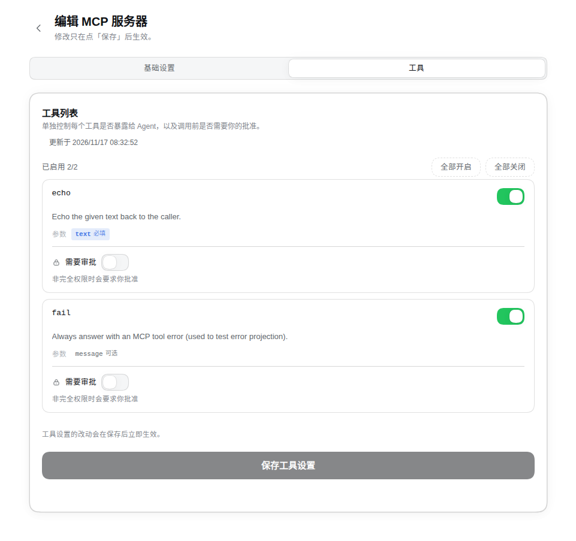
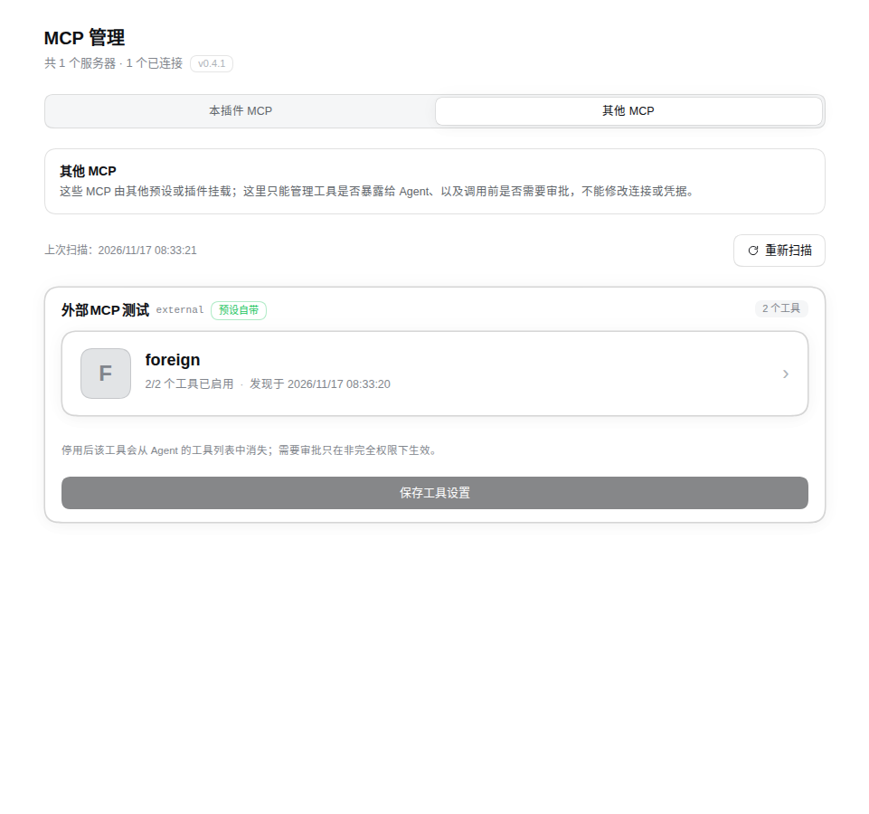
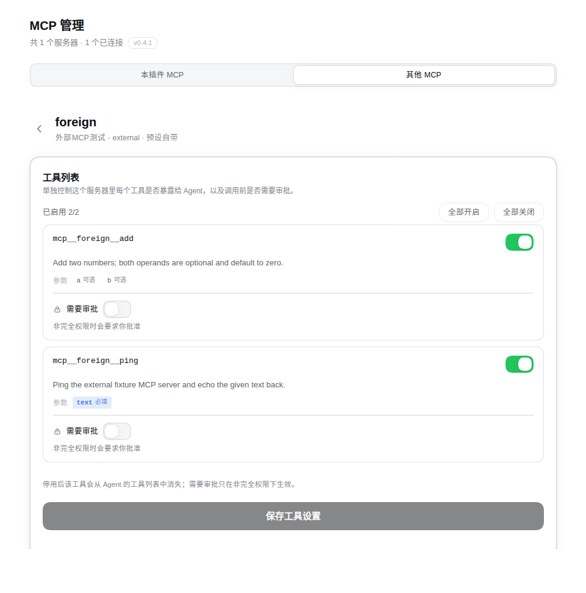

# MCP Manager for DeepSeek Harness

**MCP 管理 / MCP Manager** — manage MCP servers from the DeepSeek Harness Web GUI, and decide
per agent preset whose tools each server hands out.

<p align="center">
  
</p>

<p>
  <a href="LICENSE"></a>
  <a href="README.zh-CN.md">中文</a>
</p>

---

## What it is

DSH can already use tools from external MCP servers, configured as YAML rows in a profile. This
plugin turns that into a page: a sidebar entry **MCP 管理** (directly below **自动化任务**) opens a
full-page manager where you add, edit, group, enable, test and delete MCP servers, and can see for
each one whether it is connected, which transport it uses, how many tools it offers, and why it
failed when it did.

The part that is not just a form: **each server chooses which agent presets receive its tools**.
A database MCP server can be given to a backend preset, a browser server to a research preset, and
nothing at all to presets that should not have them — without editing preset YAML, and the change
applies to live agents as soon as you save. The same page also manages **individual tools**: hide
one tool from every agent while keeping the rest, and make a tool ask for your approval before it
runs outside full-access sessions.

MCP servers that **another preset or plugin mounts for itself** are not left out: a second tab,
**其他 MCP**, lists their inherited tools and lets you hide or gate those too, without this plugin
ever taking over their connection or credentials.

## Features

- **Full-page manager** in the sidebar, directly below 自动化任务. Rounded cards, iOS-like toggles
  and segmented controls, light and dark themes.
- **CRUD + enable/disable** for MCP servers. A disabled server keeps its settings and status, and
  can be re-enabled in one click.
- **Three transports**: HTTP (Streamable HTTP), SSE, and 内置 / stdio (a local command).
- **Custom headers** for HTTP/SSE, and **OAuth**: Disabled, a static Bearer token, or Client
  credentials.
- **Icons and groups**: a card shows the icon its MCP server declares, falls back to the name's
  first letter, or uses your own uploaded PNG/JPEG/WebP/GIF (≤512 KiB) — there is no built-in emoji
  palette. Ungrouped servers are shown last as 其他（未分组）.
- **Live status**: Connected / Connecting / Retrying / Connection failed / Disabled, enabled and
  discovered tool counts, last error with a 详情 dialog containing the full message and detail.
- **Per-server preset exposure**: 全部预设 or 指定预设 with checkboxes for the presets the Host
  offers.
- **Per-tool settings**: the edit sheet's **工具** tab lists each discovered tool with its
  description and parameters; enable or disable it, and turn on **需要审批** to ask before every
  call outside 完全权限 sessions. The card shows enabled/discovered counts, and the tab still shows
  the last known list while the server is offline.
- **Other MCP**: a **其他 MCP** page tab manages preset-owned MCP tools mounted by other presets or
  plugins — grouped by preset as a compact server list, with a per-server tool view for enable and
  **需要审批**, a rescan, and an honest caveat that the connection itself is not editable here.
- **Test connection** on an unsaved draft before saving it.
- **Per-server tool timeout**, default 60 seconds.

<p align="center">
  
</p>

## Install

The plugin is a DSH bundle. Install it into the Web profile:

```bash
dsh plugin --profile web add @ds-hu/dsh-better-mcp-manager
```

Or use the Web GUI's Plugin Manager (Plugins page → install a bundle), or let an agent install it
with `plugin_manager` (`action: install_bundle`). Reload the Web page; with HMR off, restart the
DSH Web process. Requirements: DSH 0.2.x with the Web profile, Node.js ≥ 20.19.

After install, **MCP 管理** appears in the sidebar directly below **自动化任务**. The page is
global — it is the same server list for every session (and every profile sharing this `$DSH_HOME`).

## Quick start

### 1. Add an HTTP MCP server

Press **+ 添加 MCP**, keep 传输类型 on **HTTP**, and fill in:

- **名称** — anything you recognise, e.g. `Docs search`;
- **服务器图标** — leave **自动（来自 MCP 服务端）**, or use **上传图标** / **恢复自动**
  (see [Icons](#icons));
- **服务器地址** — the MCP endpoint, e.g. `https://mcp.example.com/mcp`;
- **自定义请求头** — add `Authorization` / `Bearer …` if the server needs it, or use **OAuth 设置**
  instead;
- **预设暴露** — leave **全部预设**, or pick the presets that should receive the tools.

Press **测试连接** to probe it without saving, then **保存**. A failing connection still saves: the
card shows the error, and the server keeps retrying with backoff.

### 2. Add a stdio server

Switch 传输类型 to **内置**, then enter the command and its arguments:

- **命令** — `npx`;
- **参数** — `-y`, `@modelcontextprotocol/server-everything` (or whatever your MCP server
  documents);
- **环境变量** — add the variables the process needs;
- **工作目录** — leave empty to inherit the Host's directory.

The command runs as a child process of the DSH Host, with the Host user's privileges and
environment plus the variables you set.

### 3. Choose who gets the tools

Each server has a **预设暴露** section:

- **全部预设** — every agent, including agents without a preset id;
- **指定预设** — only the checked presets. An empty selection is legal and exposes the server to
  nobody.

<p align="center">
  
</p>

Tools are registered on the agent when it is created, and live agents are re-bound when you save a
server or toggle it, so an open session gets the tools without a restart. A session that has not
started its first turn yet is re-bound when it selects another preset.

The public tool name is `mcp__<key>__<tool>`; the key is allocated from the server name once and
never changes, so tool names stay stable across renames.

### 4. Choose which tools are exposed

Open a saved server for editing and switch to the **工具** tab. It lists every tool the server
discovered, with its description and parameter names, plus an enable switch per tool and a
**需要审批** switch. **全部开启** / **全部关闭** flip the whole list; **保存工具设置** applies the
changes to live agents immediately. The card's status line shows the **enabled / discovered** tool
counts (for example `工具 1/2` after disabling one of two tools).

The tab keeps a cached copy of the last discovered tool list, so it still shows the tools with
**更新于 …** while the server is disconnected; a brand-new server asks you to save and connect it
first. See [Tools](#tools) for what enable and approval actually do.

### 5. Watch the status

The card's status line updates every 2.5 seconds while the page is open:

```
已连接 · HTTP · 工具 19/19
连接失败 · HTTP · 工具 0
已停用 · SSE
```

The two numbers are **enabled / discovered** tools. If a server fails, the card shows the first two
lines of the error; **详情** opens the full message and transport detail. **重新连接** starts a fresh
attempt immediately; **测试连接** probes the saved server again.

### 6. Manage preset-owned MCP tools

If another agent preset or plugin mounts its own MCP servers through
`@deepseek-ai/dsh-mcp-client`, switch to the **其他 MCP** tab. It groups what it finds by preset,
marks each group **预设自带**, and shows one compact card per discovered server with its
**x/y 个工具已启用** count. Open a server card to manage its tools: full descriptions, parameter
chips, per-tool **启用** and **需要审批**, **全部开启/全部关闭**, and **保存工具设置**; **返回** goes
back to the refreshed list. There is no add/edit/delete/test here — that connection belongs to the
preset. See [Other MCP](#other-mcp).

## Icons

A server's icon is never artwork bundled with this plugin: there is no emoji palette and no built-in
icon set. It comes from exactly two places.

- **Automatic (default).** The card uses the first icon the MCP server declares in its `initialize`
  result (`serverInfo.icons`, preferring a light or unthemed icon). If the server declares none, or
  the icon cannot be fetched or is not a PNG/JPEG/WebP/GIF, the card shows the first letter of the
  server name. HTTP(S) icon URLs are fetched by the DSH Host with that server's configured headers
  and OAuth (5 s timeout, 512 KiB cap), cached in memory for 10 minutes — the browser never fetches
  them.
- **Upload.** In the server form, **服务器图标** → **上传图标** picks a local PNG/JPEG/WebP/GIF up to
  512 KiB; **恢复自动** removes it and returns to the server-declared icon. The uploaded file is
  stored under `$DSH_HOME/better-mcp-manager/icons/` (see [Data and security](#data-and-security)),
  and is deleted when you replace it, reset to automatic, or delete the server. SVG is rejected.

<p align="center">
  
</p>

## Tools

Every saved server has a **工具** tab next to **基础设置**. It is the only place that decides what
happens to the tools the server discovered; the saved server record keeps those decisions, so they
survive reconnects and restarts.

- **Enable / disable a tool.** A disabled tool is never registered for any agent or preset — it is
  absent from the model's tool list entirely, not just hidden in the page. Disabling does not stop
  the server from refreshing its tool list; it only controls exposure. A server whose tools are all
  disabled contributes neither tools nor its system-prompt instruction section to an agent.
- **Require approval per tool.** **需要审批** means "ask me before this runs, unless the session is
  in **完全权限**". The decision is made per call from the calling session's permission preset: in
  完全权限 (`danger-full-access`) the tool runs directly; in every other mode DSH shows its
  **等待审批** composer with the reason and **拒绝 / 允许一次** buttons. The MCP server is only
  called after **允许一次**; rejecting, cancelling, closing the prompt or having no approval channel
  makes the tool call fail with a readable error and never reaches the server. This is a per-call
  confirmation, not a sandbox: the Host's own permission system still applies.
- **Offline editing.** The tab works from the last known tool list when the server is disconnected
  (it says **更新于 …**). The list is refreshed whenever the server connects or when the tab is
  opened for a connected server; a tool added on the server side appears after that refresh.
- **Saving.** **保存工具设置** stores only deviations from the defaults (a disabled tool, an
  approval-required tool), re-binds every live agent immediately and updates the card counts. The
  page stays on the tab and confirms **工具设置已保存** or shows the failure.

<p align="center">
  
</p>

## Other MCP

Some MCP servers are not added on this page: an agent preset or another plugin can mount its own
`@deepseek-ai/dsh-mcp-client` rows. Those servers stay owned by that preset. This manager never
edits that YAML, never connects or disconnects those servers, and never reads their credentials —
but it can do the two things a Host plugin may safely do at runtime: **remove an inherited tool from
the model's tool list** and **make a call ask for approval** outside full-access sessions.

The page has two tabs: **本插件 MCP** (everything described above) and **其他 MCP**:

- **Grouped by preset, marked 预设自带, shown as a compact list.** Each preset that mounts MCP
  servers gets a group with its name, id, the **预设自带** badge and its tool count; under it, one
  clickable card per discovered server shows a letter tile, the server name, **x/y 个工具已启用** and,
  when known, **发现于 …**. Tool descriptions and parameters are not expanded in this list.
- **Open a server card to manage its tools.** The per-server view has a back button, the server name
  with **{preset} · {presetId} · 预设自带**, **已启用 x/y**, **全部开启 / 全部关闭**, and the full tool
  cards: description, parameter chips, **启用** and **需要审批** (approval is disabled while the tool
  itself is disabled). **保存工具设置** saves from this view and stays there; **返回** goes back to
  the refreshed list. A preset's save is also available in the list footer and is enabled only when
  something changed. Either footer explains **停用后该工具会从 Agent 的工具列表中消失；需要审批只在
  非完全权限下生效**.
- **Discovery is live.** The tab scans the tools visible to live agents, so a preset's tools appear
  after at least one session using that preset has run. A preset that mounts an MCP client but has
  no live session yet gets a placeholder: **打开一次使用该预设的会话后自动同步，也可以点「重新扫描」**.
  **重新扫描** re-runs discovery; the last scan time is shown as **上次扫描：…**.
- **The connection is out of scope.** There is no add, edit, delete, test or reconnect for these
  servers; change the preset/plugin that owns them for that.
- **Persistence.** The choices and the last discovered descriptors live in
  `$DSH_HOME/better-mcp-manager/external.json` (mode `0600`), never credentials. Deleting that file
  (or running `clean --yes`) returns everything to the defaults: enabled, no approval.
- **Approval follows your DSH policy.** The request is passed to the Host's approval pipeline. If
  your OAuth/approval policy is set to `never`, an ask is denied rather than displayed — this plugin
  cannot override the policy, only ask for it.

<p align="center">
  
</p>

<p align="center">
  
</p>

## Data and security

- All plugin state is two JSON files inside `$DSH_HOME/better-mcp-manager/` (mode `0700`):
  `servers.json` for the servers this plugin owns and `external.json` for preset-owned MCP tool
  settings and descriptors, plus uploaded icons in `icons/` (each file `0600`). Nothing is written
  to the profile, to preset YAML or to the sessions directory. Mounting the plugin creates the data
  directory; `servers.json` appears when you save the first server, `external.json` on the first save
  on the 其他 MCP tab. Server-declared HTTP icons are fetched by the Host and cached in memory only —
  they are never written to disk. Per-tool enable/approval choices and the cached tool descriptors
  (name, public name, description, parameter names, timestamps) are stored in those JSON files; the
  caches never contain headers, tokens or other credentials.
- **Secrets are stored in `servers.json` in plaintext**: custom header values, a bearer token and a
  `client_credentials` secret. Protect the machine and the file; do not commit it, paste it into an
  issue, or copy it to a shared host.
- The HTTP API is served by the Host's own web server under `/better-mcp-manager/api` and is
  same-origin only: every write is Origin-checked, requests with a body must be
  `Content-Type: application/json`, and bodies are capped at 64 KiB — except the icon upload, whose
  JSON envelope may reach 1 MiB for at most 512 KiB of decoded image. There is no separate port and
  no extra authentication beyond the Harness's own.
- **Uploaded icons are served back by the Host** with `X-Content-Type-Options: nosniff` and
  `Cache-Control: private, max-age=300`; SVG is rejected because a same-origin SVG document can run
  script.
- **A stdio server is a program you ask DSH to run.** Only add commands you trust. HTTP servers
  receive the headers and tokens you configure, including for their declared icon URL.

The JSON file is small and readable; keep a copy of the directory if you want to restore the list
and the icons, or delete it with the clean CLI (below) to remove every trace.

## Uninstall

Remove the bundle, then delete the one data directory (server list, per-tool settings, preset-owned
MCP settings and uploaded icons):

```bash
# 1. remove the bundle — CLI, Plugins page (Remove), or plugin_manager remove_bundle
dsh plugin --profile web remove @ds-hu/dsh-better-mcp-manager

# 2. delete stored servers (optional; skip to keep the list for a reinstall)
npx -y @ds-hu/dsh-better-mcp-manager clean --yes
```

From a checkout, the same command is `node bin/mcp-manager.mjs clean --yes`. The manual equivalent
is `rm -rf "$DSH_HOME/better-mcp-manager"`. The remove command drops the dependency and the bundle
row itself, so nothing is left in the profile: no install scripts ran, and there are no services or
timers to clean up. `clean` is the only remaining step, and only because the server list is yours to
keep or delete; it removes the whole directory, including `icons/`. Reload the page afterwards: a
page that was already open remembers the old sidebar entry until it reloads.

`clean` **requires `--yes`** — without it the command refuses and exits non-zero, so it is safe to
run by accident. It also refuses any directory that is not a `better-mcp-manager` data directory,
and prints the path it removed. `node bin/mcp-manager.mjs status` (the default command) shows what
is stored (directory mode, schema, servers, enabled count), and `node bin/mcp-manager.mjs path`
prints the data directory. Both only read.

## Compatibility and limitations

- **Tools and server instructions only.** 0.4.1 does not expose MCP resources, resource templates,
  prompt templates or sampling. A server that offers only resources has nothing to show here.
- **One connection per enabled server**, shared by every agent the server is exposed to. Tools are
  registered per agent preset and per tool: only the enabled tools of an allowed server reach an
  agent.
- **Per-tool settings are enable and approval only.** There are no per-tool preset rules, no
  per-tool timeout and no per-tool schema override, and approval is a per-call confirmation, not a
  replacement for the Host's permission system.
- **Approval is skipped exactly in 完全权限.** In the `danger-full-access` permission preset a
  **需要审批** tool runs without asking; every other preset asks. If the Host exposes no approval
  service (or the call has no agent), an approval-required tool is denied rather than allowed.
- **OAuth settings are bearer or client-credentials only.** There is no authorization-code/PKCE
  flow, so a server that requires an interactive browser login cannot be connected in 0.4.1.
- **No YAML import or migration.** MCP servers configured through the built-in
  `@deepseek-ai/dsh-mcp-client` rows keep working untouched. The **其他 MCP** tab can hide or gate
  their tools, but it never imports, edits or owns those rows; deleting anything on this page never
  touches them.
- **其他 MCP is runtime-only.** It manages tools that are already registered by a live preset; it
  cannot create, edit, test or reconnect those servers, and it never reads their credentials.
- **其他 MCP discovery needs a live session of that preset.** Descriptors come from live agents, so a
  preset that mounts an MCP client but has no session yet shows a placeholder until one runs (or
  until a rescan sees one).
- **Approval depends on the Host's approval policy.** An ask is passed to the Host; if the policy is
  `never` (a DSH-level setting this plugin does not control), the ask is denied instead of shown.
- **其他 MCP state is in a second file.** `external.json` stores only descriptors and deviations
  (`enabled:false` / `approval:true`); it never stores credentials, and `clean --yes` removes it
  with the rest of the data directory.
- **HTTP/SSE servers must be reachable from the DSH Host**, not from the browser. `localhost` in
  the URL means the host's localhost.
- **No built-in icons.** An icon is either declared by the MCP server or uploaded by you; there is
  no emoji palette, no stock icon set, and no user-entered emoji string.
- **Automatic icons are best-effort.** The server must declare `serverInfo.icons`; a remote icon is
  capped at 5 s and 512 KiB and must be PNG/JPEG/WebP/GIF. Otherwise the card shows the first letter
  of the server name.
- **Uploads are raster only.** PNG, JPEG, WebP and GIF up to 512 KiB; SVG is rejected on purpose.
- **Preset selection is fixed once a session's first turn starts.** Choose the preset before the
  conversation begins; the binder re-binds a blank session when it selects another preset.
- **The tool list in the 工具 tab can be stale while offline.** It shows the descriptors cached from
  the last `tools/list`; reconnect (or open the tab on a connected server) to refresh it. Tool
  settings themselves are always current.
- The server list lives per `$DSH_HOME`, not per profile: profiles under the same DSH home share
  it. Use a separate `$DSH_HOME` if you need an isolated list.

## Troubleshooting

| Symptom | Check |
|---|---|
| **连接失败** with a connection error | Is the server running and reachable from the DSH host? Is the URL the MCP endpoint (usually `…/mcp`)? HTTP and SSE are different transports — use the one the server documents. |
| **连接失败** with an auth error | Does the server expect a header or OAuth? A custom `Authorization` header wins over a bearer token. Client-credentials fields must match the identity provider. |
| **连接失败** for a stdio server | Is the command on the Host's `PATH`? Do the arguments exist? Open **详情**; a command-not-found or exit error is in the detail. |
| Tools do not appear in a session | Is the server **已连接**? Is the session's preset in the server's **指定预设** list? Is the tool enabled in the edit sheet's **工具** tab? Did the session start before the server was added — save again or open a new session to re-bind it. |
| A **需要审批** tool runs without asking | The session is in **完全权限** (`danger-full-access`): approval is deliberately skipped there. Switch the session's permission preset to ask again. |
| An approval-required tool call fails without a prompt | The Host exposed no approval channel, the call had no agent, or the prompt was rejected/cancelled. The tool is denied before the MCP server is called; start the call from a normal session. |
| Tools from two servers collide | Public tool names are namespaced by each server's immutable key. If a name still clashes, the two servers' raw tool names collide after normalisation — delete and re-add one server (which allocates a new key) or remove the colliding tool. |
| A card shows a letter instead of the server's icon | The MCP server declares no icon, or its icon could not be fetched within 5 s / 512 KiB / a supported raster type. The letter is the documented fallback; upload an icon to override it. |
| Uploading an icon fails | Only PNG/JPEG/WebP/GIF up to 512 KiB are accepted (SVG is not); the form validates the file before upload and shows the reason. |
| Save answers `403` | A reverse proxy that rewrites the `Host` header breaks the same-origin check. Preserve the original `Host` for the DSH web port. |
| **保存工具设置** fails | The server record was deleted in another window, or the Host restarted. Reload the page and reopen the tab; the previous settings are untouched. |
| The **工具** tab shows an old tool list | The server is disconnected and the tab is showing **更新于 …** from the last discovery. Reconnect the server (or reopen the tab on a connected one) to refresh. |
| **其他 MCP** is empty | No preset mounts `@deepseek-ai/dsh-mcp-client`, or none of their tools have been discovered yet. Open a session using that preset, then press **重新扫描**. |
| **其他 MCP** shows a preset but no tools | The preset mounts an MCP client but no live session of it exists yet. Open one session with that preset; the placeholder explains this. |
| A toggle in **其他 MCP** does nothing | Press that preset's **保存工具设置** — switches are local until saved (the save button enables only when something changed). |
| A **需要审批** external tool is denied without a prompt | Your DSH approval policy may be `never`, which denies asks rather than displaying them. Change the policy in DSH or run in a restricted preset that can ask. |
| The page shows an empty list with no error | The Host half is not running: check that the bundle is enabled and `GET /better-mcp-manager/api/health` answers. |

## Documentation

| Document | What is in it |
|---|---|
| [docs/TECHNICAL.md](docs/TECHNICAL.md) | Architecture, icon model, tool management, preset-owned MCP, approval seams, data model, HTTP API, security, lifecycle, uninstall, testing |
| [CONTEXT.md](CONTEXT.md) | The vocabulary and invariants this plugin is built on |
| [docs/adr](docs/adr) | Why the design is what it is |
| [docs/API-CONTRACT.md](docs/API-CONTRACT.md) | The frozen Host/Client/data contract |

## License

MIT. See [LICENSE](LICENSE). Third-party attribution is in [NOTICE](NOTICE).
