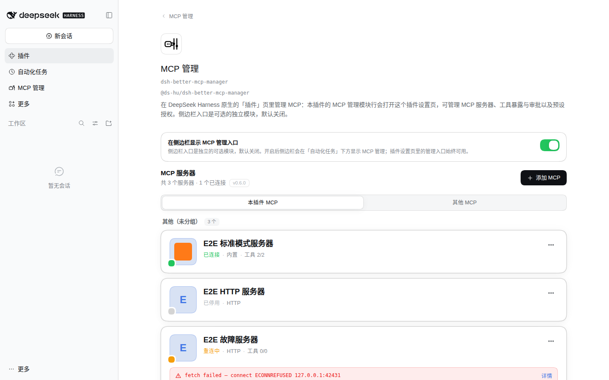

# 面向 DeepSeek Harness 的 MCP 管理

**MCP 管理 / MCP Manager** —— 在 DSH 的「插件」页里管理 MCP 服务器，并按 Agent 预设决定每个
服务器的工具交给谁。

<p align="center">
  
</p>

<p>
  <a href="LICENSE"></a>
  <a href="README.md">English</a>
</p>

---

## 它是什么

DSH 本来就能使用外部 MCP 服务器提供的工具，方式是在 profile 里写 YAML 行。这个插件把这件事搬到
插件自己的设置页：打开 **插件** 页，选中 **MCP 管理** 插件卡片，进入 **MCP 管理** 模块行，点行名
或 **配置 MCP 管理** 控件。添加、编辑、分组、启用、测试、删除 MCP 服务器都在这个页面里；每台
服务器是否已连接、用的哪种传输、有多少个工具、失败原因是什么，也都写在卡片上。

原来的侧边栏入口现在是**可选的独立模块**，默认关闭，在同一个插件设置页里打开（见
[打开管理器](#打开管理器)）。全新安装不会在侧边栏多出任何一行。

它不只是个表单：**每台服务器可以自己决定把工具交给哪些 Agent 预设**。数据库 MCP 只给后端预设，
浏览器 MCP 只给研究预设，其余预设一个工具也拿不到——不用改预设 YAML，保存后立刻对运行中的 Agent
生效。同一个页面也能管理**单个工具**：把某个工具对所有 Agent 隐藏、其余照常，或者让某个工具在
非完全权限的会话里调用前先向你申请批准。

**其他预设或插件挂载的 MCP 服务器**也不会被落下：第二个标签 **其他 MCP** 会列出这些继承来的工具，
同样可以隐藏或要求审批，但插件不会接管它们的连接或凭据。

## 功能

- **管理器在插件自己的设置页里**：**插件** → **MCP 管理** 插件卡片 → **MCP 管理** 模块行 →
  **配置 MCP 管理**，由 DSH 原生的插件页渲染。圆角卡片、iOS 风格的开关与分段控件，深浅色主题都
  跟随 DSH。
- **可选的侧边栏入口**：这个插件设置页上的一个开关可以把 **MCP 管理** 放回侧边栏、就在
  **自动化任务** 正下方。它默认关闭，切换立即生效，选择由 Host 持久化——不是存在这个浏览器里
  ——所以同一个 `$DSH_HOME` 下的每个浏览器和 profile 看到的都一样。
- **增删改查 + 启用/停用**。停用的服务器保留全部设置和状态，点一下就能重新启用。
- **三种传输类型**：HTTP（Streamable HTTP）、SSE、内置（stdio，本机命令）。
- **自定义请求头**（HTTP/SSE），以及 **OAuth 设置**：不启用、静态 Bearer Token、客户端凭证模式。
- **图标与分组**：卡片显示 MCP 服务器自己声明的图标，没有就回退到名称首字，也可以用你上传的
  PNG/JPEG/WebP/GIF（≤512 KiB）——没有内置 emoji 调色板。列表按分组排列，未分组的排在最后，
  显示为 其他（未分组）。
- **实时连接状态**：已连接 / 连接中 / 重连中 / 连接失败 / 已停用，已启用/已发现工具数量，失败时
  的错误气泡和 **详情** 对话框（完整 message 与 detail）。
- **按服务器选择预设暴露**：全部预设，或指定预设（勾选 Host 提供的预设）。
- **按工具设置**：编辑表单的 **工具** 标签列出每个已发现的工具及其说明和参数；可以单独启用/停用，
  也可以打开 **需要审批**，让工具在非 **完全权限** 的会话里每次调用前先问你。卡片显示
  已启用/已发现数量；服务器离线时这个标签仍能显示上次缓存的工具列表。
- **其他 MCP**：页面第二个标签 **其他 MCP** 管理由其他预设或插件挂载的 MCP 工具——按预设分组
  显示紧凑的服务器列表，点进单台服务器的工具视图后逐个启用、设置 **需要审批**，带重新扫描，并
  明确说明这里不能修改连接本身。
- **测试连接**：不用保存就能先探一下草稿。
- **每台服务器单独的工具调用超时**，默认 60 秒。

<p align="center">
  
</p>

## 打开管理器

**管理器就是插件自己的设置页。** 在侧边栏打开 **插件**（英文界面 **Plugins**），找到
**MCP 管理**（英文界面 **MCP Manager**）插件卡片，打开它，再进入 **MCP 管理** 模块行——点行名
或标着 **配置 MCP 管理**（英文界面 **Configure MCP Manager**）的配置控件。这个模块行的设置页在
插件页里打开，页面里既有侧边栏入口开关，也有完整的管理器：先是一张开关卡片，接着是 **MCP
服务器** 区域（服务器数量、版本、**添加 MCP** 按钮和服务器列表）。卡片、模块行和页面标题的中文
都是 **MCP 管理**，英文是 **MCP Manager**。全新安装的侧边栏里没有入口可点，DSH 通用的 **设置**
对话框里也不再放这个管理器——一切都从这个插件页面开始。

**侧边栏入口现在是一个独立、可选的模块。** 在同一个插件设置页上打开
**在侧边栏显示 MCP 管理入口**（英文界面 **Show MCP Manager in the sidebar**）这个开关，侧边栏
就会多出一行 **MCP 管理**，位置就在 **自动化任务** 正下方。点这一行会把同一个管理器作为独立页面
打开。关掉开关会立即注销这一行和这个页面；如果当时正停在该页面，DSH 会回到会话。插件页面
始终都在——可选的只是侧边栏模块。

<p align="center">
  
</p>

这个开关是 **Host 侧偏好**，和插件的其他数据存在一起（见 [数据与安全](#数据与安全)）：
同一个 `$DSH_HOME` 下的每个浏览器、每个 profile 共用它；刷新页面、重启 Host 都不会丢；
它**不是**按浏览器保存的 `localStorage`。

> **前提：**插件设置页需要 DSH 原生的「插件」页（`@deepseek-ai/dsh-client-ui-plugin-manager`，
> 随附的 Web 应用已包含它）。如果某个部署没有组合插件页，这个插件就没有默认入口；此时只要启用
> 可选侧边栏模块，仍然可以用独立页面打开管理器。这里刻意没有「退回通用设置分区」的兜底。

**从 0.5.x 升级？**管理器从通用的 **设置** 对话框搬到了插件自己的页面：**插件 → MCP 管理 →
MCP 管理 → 配置 MCP 管理**。原来的 **设置 → MCP 管理** 分区已经移除。已保存的服务器、工具设置、
其他 MCP 的选择和侧边栏偏好都不受影响；如果之前开着可选侧边栏模块，它会保持开启。（**从 0.4.x
升级：**以前管理器只有侧边栏页面，请使用插件页面，或者在插件设置页里重新打开可选侧边栏模块。）

## 安装

插件是一个 DSH bundle（本 README 对应 **0.6.0** 版本），装进 Web profile：

```bash
dsh plugin --profile web add @ds-hu/dsh-better-mcp-manager
```

也可以用 Web 界面的插件管理页（Plugins 页 → 安装 bundle），或者让 Agent 用 `plugin_manager`
（`action: install_bundle`）代装。装完刷新页面；如果 profile 没开 HMR，需要重启 DSH Web 进程。
要求：DSH 0.2.x 的 Web profile，Node.js ≥ 20.19。

装好后，打开 **插件** 页和 **MCP 管理** 插件卡片（见 [打开管理器](#打开管理器)）；管理器是
全局的：所有会话共用同一份服务器列表（同一个 `$DSH_HOME` 下的 profile 也共用），不跟着会话走。
全新安装刻意不在侧边栏显示入口：侧边栏入口是可选模块，在插件设置页里打开。

## 快速开始

### 1. 添加一个 HTTP MCP 服务器

打开 **MCP 管理** 插件页（**插件** → **MCP 管理** 卡片 → **MCP 管理** 模块行 → **配置
MCP 管理**），点 **+ 添加 MCP**，传输类型保持 **HTTP**，填写：

- **名称**——自己认得就行，例如 `Docs search`；
- **服务器图标**——保持 **自动（来自 MCP 服务端）**，或使用 **上传图标** / **恢复自动**
  （见 [图标](#图标)）；
- **服务器地址**——MCP 端点，例如 `https://mcp.example.com/mcp`；
- **自定义请求头**——需要的话加 `Authorization` / `Bearer …`，或者改用 **OAuth 设置**；
- **预设暴露**——保持 **全部预设**，或勾选需要这些工具的预设。

可以先用 **测试连接** 探一下（不保存），再 **保存**。连接失败也照样保存：卡片上会写明原因，
服务器按退避策略继续重试。

### 2. 添加一个 stdio 服务器

传输类型切到 **内置**，填命令和参数：

- **命令**——`npx`；
- **参数**——`-y`、`@modelcontextprotocol/server-everything`（以你的 MCP 服务器文档为准）；
- **环境变量**——进程需要的变量；
- **工作目录**——留空表示沿用 Host 的目录。

这个命令会作为 DSH Host 的子进程运行，使用 Host 用户的权限和环境，再叠加你设置的环境变量。

### 3. 选择谁能拿到工具

每台服务器都有 **预设暴露** 一栏：

- **全部预设**——所有 Agent，包括没有预设 id 的 Agent；
- **指定预设**——只给勾选的预设。一个都不勾也是合法的，表示这台服务器不对任何 Agent 暴露。

<p align="center">
  
</p>

工具在 Agent 创建时注册；保存服务器或切换启用状态时，运行中的 Agent 会被重新绑定，所以不用重启
就能在已打开的会话里看到变化。还没开始第一轮对话的会话，在切换预设时会按新预设重新绑定。

对模型暴露的工具名是 `mcp__<key>__<工具名>`。`key` 在创建服务器时由名称生成一次，之后永不改变，
所以重命名服务器不会改工具名。

### 4. 选择暴露哪些工具

打开已保存服务器的编辑表单，切到 **工具** 标签。这里列出服务器发现的全部工具，带说明和参数名；
每个工具有一个启用开关和一个 **需要审批** 开关。**全部开启** / **全部关闭** 可以一次改完整个
列表；**保存工具设置** 立即对运行中的 Agent 生效。卡片状态行显示 **工具 已启用/已发现**（例如
两个工具里停用一个后是 `工具 1/2`）。

这个标签会缓存最后一次发现的工具列表，所以服务器断开时仍会显示，并标明 **更新于 …**；刚创建的
服务器会提示先保存并连接。启用和审批的具体行为见 [工具](#工具)。

### 5. 看连接状态

管理器打开时，卡片的状态行每 2.5 秒刷新一次：

```
已连接 · HTTP · 工具 19/19
连接失败 · HTTP · 工具 0
已停用 · SSE
```

这两个数字是 **已启用 / 已发现** 工具数。连接失败时卡片显示错误的前两行，点 **详情** 看完整
message 和传输层的 detail。**重新连接** 会立刻发起一次新的连接；**测试连接** 再探一次已保存的
配置。

### 6. 管理预设自带的 MCP 工具

如果其他 Agent 预设或插件通过 `@deepseek-ai/dsh-mcp-client` 挂载了自己的 MCP 服务器，切到
**其他 MCP** 标签。它会按预设分组、标上 **预设自带**，每台发现的服务器显示为一张紧凑卡片，带
**x/y 个工具已启用**。点开服务器卡片进入工具视图，才能看到完整说明、参数标签，并逐个启用/停用、
设置 **需要审批**，或用 **全部开启/全部关闭** 批量修改；**保存工具设置** 保存在这个视图里，
**返回** 回到刷新后的列表。这里没有添加、编辑、删除或测试——那条连接属于预设。详见
[其他 MCP](#其他-mcp)。

## 图标

服务器图标不是插件自带的图片：没有 emoji 调色板，也没有内置图标库。来源只有两个。

- **自动（默认）**：卡片使用 MCP 服务器在 `initialize` 结果里声明的第一个图标
  （`serverInfo.icons`，优先无主题或浅色主题的那个）。服务器没声明、图标取不到、或不是
  PNG/JPEG/WebP/GIF 时，卡片显示服务器名称的首字。HTTP(S) 图标由 DSH Host 带着这台服务器配置的
  请求头和 OAuth 去取（5 秒超时、512 KiB 上限），在内存里缓存 10 分钟——浏览器不会去取。
- **上传**：在服务器表单里，**服务器图标** → **上传图标** 选择本机的 PNG/JPEG/WebP/GIF，最大
  512 KiB；**恢复自动** 会删掉上传的图标，回到服务端声明的图标。上传的文件保存在
  `$DSH_HOME/better-mcp-manager/icons/`（见 [数据与安全](#数据与安全)），替换、恢复自动或删除
  服务器时都会删掉。不接受 SVG。

<p align="center">
  
</p>

## 工具

每台已保存的服务器除了 **基础设置** 还有 **工具** 标签。服务器发现的工具怎么处理，只在这里决定；
这些设置保存在服务器记录里，所以重连、重启都不会丢。

- **启用 / 停用单个工具。** 停用的工具不会注册给任何 Agent 或预设——它从模型的工具列表里彻底
  消失，而不只是在页面上隐藏。停用不影响服务器继续刷新工具列表，只控制是否暴露；一台服务器的
  工具全部停用时，它既不贡献工具，也不贡献自己的 system prompt instructions。
- **按工具要求审批。** **需要审批** 的意思是“除非会话在 **完全权限**，否则调用前问我”。每次调用
  都会读取调用会话的权限预设：在完全权限（`danger-full-access`）下直接执行；其他模式下 DSH 会
  弹出 **等待审批** 对话框，写明原因，并提供 **拒绝 / 允许一次**。只有点了 **允许一次** 才会调用
  MCP 服务器；拒绝、取消、关闭对话框，或者 Host 没有审批服务，调用都会以可读错误失败，并且不会
  到达服务器。这是逐次确认，不是沙箱：Host 自己的权限系统照常生效。
- **离线也能编辑。** 服务器断开时标签显示上次已知的工具列表，并标明 **更新于 …**。服务器连接时
  或对已连接服务器打开标签时会刷新；服务器端新增的工具会在刷新后出现。
- **保存。** **保存工具设置** 只存与默认值不同的项（停用的工具、需要审批的工具），立即重新绑定
  所有运行中的 Agent，并更新卡片计数。管理器留在标签内，成功显示 **工具设置已保存**，失败显示原因。

<p align="center">
  
</p>

## 其他 MCP

有些 MCP 服务器不是在这个页面添加的：Agent 预设或其他插件可以挂载自己的
`@deepseek-ai/dsh-mcp-client` 行。这些服务器归那个预设所有。本插件从不修改那些 YAML、不连接或
断开它们、也不读取它们的凭据；它只做 Host 插件在运行时能安全做的两件事：**把继承来的工具从模型
的工具列表中移除**，以及**让调用在非完全权限下先申请审批**。

管理器有两个标签：**本插件 MCP**（上面介绍的全部功能）和 **其他 MCP**：

- **按预设分组，标上 预设自带，默认是紧凑列表。** 每个挂载了 MCP 的预设一组，显示名称、id、
  **预设自带** 徽标和工具数量；下面是每台发现的服务器一张可点击卡片，带首字图标、服务器名、
  **x/y 个工具已启用**，已知时还显示 **发现于 …**。工具说明和参数不在这层展开。
- **点开服务器卡片管理工具。** 单台服务器的工具视图里有返回按钮、服务器名与
  **{预设} · {预设ID} · 预设自带**、**已启用 x/y**、**全部开启 / 全部关闭**，以及完整的工具卡片：
  说明、参数标签、**启用** 和 **需要审批**（工具停用时审批开关不可用）。**保存工具设置** 在这个
  视图里保存并停留；**返回** 回到刷新后的列表。列表页脚也有同一预设的保存按钮，只在有改动时可用。
  两处页脚都说明 **停用后该工具会从 Agent 的工具列表中消失；需要审批只在非完全权限下生效**。
- **发现是实时的。** 这个标签扫描运行中 Agent 可见的工具，所以某个预设的工具要在至少有一个使用
  该预设的会话运行后才会出现。挂了 MCP 客户端但还没有活动会话的预设会显示占位提示：
  **打开一次使用该预设的会话后自动同步，也可以点「重新扫描」**。**重新扫描** 会重新发现，
  并显示 **上次扫描：…**。
- **连接本身不在这里管。** 这些服务器没有添加、编辑、删除、测试或重连；要改连接请改拥有它们的
  预设/插件。
- **持久化。** 选择结果和上次发现的工具描述保存在
  `$DSH_HOME/better-mcp-manager/external.json`（`0600`），绝不保存凭据。删除这个文件（或运行
  `clean --yes`）会把一切恢复默认：启用、不需要审批。
- **审批遵循你的 DSH 策略。** 请求会交给 Host 的审批流程。如果审批策略被设为 `never`，请求会被
  拒绝而不是显示出来——本插件不能覆盖该策略，只能发起请求。

<p align="center">
  
</p>

<p align="center">
  
</p>

## 数据与安全

- 插件的配置是三个 JSON 文件，都在 `$DSH_HOME/better-mcp-manager/`（目录 `0700`）里：
  `servers.json` 存本插件自己的服务器，`external.json` 存预设自带 MCP 的工具设置和描述，
  `preferences.json` 存界面偏好（目前只有一项：可选侧边栏入口是否开启）；上传的图标放在同目录的
  `icons/` 子目录里（每个文件 `0600`）。它不往 profile、预设 YAML 或会话目录写任何东西。挂载插件
  时会创建数据目录；保存第一台服务器后才出现 `servers.json`，第一次在 其他 MCP 页保存工具设置后
  才出现 `external.json`，第一次切换侧边栏入口开关后才出现 `preferences.json`。MCP 服务端声明的
  HTTP 图标由 Host 取回、只缓存在内存里——不会写到磁盘。每个工具的启用/审批设置和缓存的工具描述
  （原始名、公开名、说明、参数名、时间）也存在这些 JSON 里；缓存不包含请求头、Token 或其他凭据。
- **侧边栏入口偏好存在 Host 侧，不在浏览器里。** 它保存在 `preferences.json`
  （`{ "version": 1, "sidebarEntry": false }`），由
  `GET`/`PUT /better-mcp-manager/api/preferences` 读写；同一个 `$DSH_HOME` 下的每个浏览器、
  每个 profile 共用同一个选择。不存在按浏览器保存的 `localStorage` 开关。
- **密钥以明文保存在 `servers.json` 里**：自定义请求头的值、Bearer Token、客户端凭证的 secret。请保护
  这台机器和这个文件；不要把它提交到仓库、贴进 issue，或复制到共享主机。
- HTTP 接口挂在 Host 自己的 Web 服务器上，路径 `/better-mcp-manager/api`，仅限同源：所有写操作都
  校验 Origin，带请求体的调用要求 `Content-Type: application/json`，请求体上限 64 KiB——图标上传
  是例外，它的 JSON 信封最大 1 MiB，解码后的图片最多 512 KiB。没有额外端口，除了 DSH 自带的 Web
  认证之外没有别的认证。
- **上传的图标由 Host 原样返回**：带 `X-Content-Type-Options: nosniff` 和
  `Cache-Control: private, max-age=300`；SVG 会被拒绝，因为同源的 SVG 文档可以执行脚本。
- **内置服务器就是交给 DSH 去运行的程序**，只添加你信任的命令。HTTP 服务器会收到你配置的请求头
  和 Token，包括为它声明的图标 URL 发起的请求。

JSON 文件很小、可读；想连偏好和图标一起备份就复制整个目录，想彻底删掉就用下面的清理命令。

## 卸载

先移除 bundle，再删掉唯一的数据目录（服务器列表、按工具设置、其他 MCP 设置、侧边栏入口偏好和
上传的图标都在里面）：

```bash
# 1. 移除 bundle —— CLI、Plugins 页的 Remove，或 plugin_manager remove_bundle
dsh plugin --profile web remove @ds-hu/dsh-better-mcp-manager

# 2. 删除已保存的服务器（可选；想以后重装时恢复列表就跳过）
npx -y @ds-hu/dsh-better-mcp-manager clean --yes
```

从源码目录运行时，同一条命令是 `node bin/mcp-manager.mjs clean --yes`；等价的手工操作是
`rm -rf "$DSH_HOME/better-mcp-manager"`。移除命令会自己清掉依赖和 bundle 行，所以在 profile 里
不留东西：没有运行过安装脚本，也没有服务或定时器要清。只剩 `clean` 这一步，而且只是因为服务器
列表是留是删由你决定；它会把整个目录删掉，包括 `preferences.json` 和 `icons/`。卸载后刷新一下
页面——还开着的旧页面会继续显示旧的插件页面（配置控件已失效），如果入口开着也会继续显示那个
已经失效的侧边栏入口，直到刷新为止。

`clean` **必须带 `--yes`**：不带就拒绝执行并以非零状态退出，误敲也不会删东西。它同样拒绝任何
名字不是 `better-mcp-manager` 的数据目录，删完会打印实际删掉的路径。
`node bin/mcp-manager.mjs status`（默认命令）显示存了什么（目录权限、schema、服务器列表、启用数量，
以及可选侧边栏模块是否开启），`node bin/mcp-manager.mjs path` 打印数据目录；这两条都只读。

## 兼容性与限制

- **插件设置页需要 DSH 原生的「插件」页。** 随附的 Web 应用已经组合了它；如果某个部署没有组合
  插件页，这个插件就没有默认入口。此时只要启用可选侧边栏模块，仍然可以用独立页面打开管理器。
  这里没有「退回通用设置分区」的兜底。
- **侧边栏入口要手动启用，且是 Host 侧偏好。** 全新安装不会在侧边栏显示入口。插件设置页上的开关
  写入的是 Host 偏好，同一个 `$DSH_HOME` 下的每个浏览器和 profile 共用；它不是按浏览器保存的
  `localStorage`，换一个 `$DSH_HOME` 就是另一个选择。
- **只处理工具和服务器 instructions。** 本插件不暴露 MCP resources、资源模板、prompt 模板和
  sampling。只有 resource 的服务器在这里没有可展示的内容。
- **每台启用的服务器只有一条连接**，由所有被暴露的 Agent 共用。工具按 Agent 预设、也按工具注册：
  只有被允许的服务器里被启用的工具才会到达 Agent。
- **按工具的设置只有启用与审批。** 没有按工具的预设规则、按工具的超时或 schema 覆盖；审批是
  逐次调用的确认，不替代 Host 的权限系统。
- **只在完全权限下跳过审批。** 在 `danger-full-access` 权限预设里，**需要审批** 的工具直接执行；
  其他预设都会询问。Host 没有审批服务（或调用没有 Agent）时，需要审批的工具会被拒绝，而不是
  被放行。
- **OAuth 只支持 Bearer Token 与客户端凭证**。没有授权码 / PKCE 流程，所以需要浏览器交互登录的
  服务器在这里连不上。
- **不导入、不迁移 YAML 配置。** 通过内置 `@deepseek-ai/dsh-mcp-client` 行配置的 MCP 服务器照常
  工作。**其他 MCP** 标签可以隐藏或要求审批它们的工具，但本插件从不导入、修改或接管这些行；
  在这个页面上的任何删除都不会碰到它们。
- **其他 MCP 只在运行时生效。** 它管理的是活动预设已经注册的工具，不能创建、编辑、测试或重连
  那些服务器，也从不读取它们的凭据。
- **其他 MCP 的发现需要该预设有一个活动会话。** 工具描述来自运行中的 Agent，所以只挂了 MCP
  客户端、还没有会话的预设会显示占位提示，直到有会话运行（或重新扫描时看到会话）。
- **审批取决于 Host 的审批策略。** 请求交给 Host；如果策略是 `never`（DSH 级设置，本插件不能
  控制），请求会被拒绝而不是显示。
- **其他 MCP 的状态在第二个文件里。** `external.json` 只存工具描述和与默认值的偏差
  （`enabled:false` / `approval:true`），从不存凭据；`clean --yes` 会把它和整个数据目录一起删掉。
- **HTTP/SSE 服务器必须从 DSH Host 可达**，不是从浏览器可达。URL 里的 `localhost` 指 Host 的
  localhost。
- **没有内置图标。** 图标只能来自 MCP 服务端声明或你自己的上传；没有 emoji 调色板、没有内置图标
  集，也不能填 emoji 字符串。
- **自动图标是尽力而为。** 服务器要在 `serverInfo.icons` 里声明；远程图标受 5 秒 / 512 KiB /
  PNG/JPEG/WebP/GIF 限制，否则卡片显示名称首字。
- **上传只支持栅格图。** PNG、JPEG、WebP、GIF，最大 512 KiB；SVG 会被拒绝。
- **第一轮对话开始后，预设就固定了。** 请在对话开始前选好预设；还没开始第一轮对话的空白会话
  在切换预设时，会按新预设重新绑定。
- **离线时 工具 标签里的列表可能过期。** 它显示最后一次 `tools/list` 缓存的描述；重连服务器
  （或对已连接服务器重新打开标签）才会刷新。工具设置本身始终是最新的。
- 服务器列表按 `$DSH_HOME` 存放，不按 profile 隔离：同一个 DSH home 下的 profile 共用一份列表。
  需要独立列表就换一个 `$DSH_HOME`。

## 常见问题

| 现象 | 检查 |
|---|---|
| **连接失败**，错误指向网络 | 服务器在运行吗？从 DSH Host 能访问吗？URL 是 MCP 端点吗（通常以 `/mcp` 结尾）？HTTP 和 SSE 是两种传输，选服务器文档写的那个。 |
| **连接失败**，错误指向认证 | 服务器要的是请求头还是 OAuth？自定义 `Authorization` 请求头优先于 Bearer Token；客户端凭证的字段要和身份提供方一致。 |
| 内置服务器 **连接失败** | 命令在 Host 的 `PATH` 里吗？参数存在吗？看 **详情**：命令找不到、进程退出码都在 detail 里。 |
| 会话里看不到工具 | 服务器是 **已连接** 吗？会话的预设在这个服务器的 **指定预设** 里吗？工具在编辑表单的 **工具** 标签里启用了吗？会话是不是在添加服务器之前就开始了——再保存一次，或者新开会话让它重新绑定。 |
| **需要审批** 的工具没有询问就直接运行 | 会话在 **完全权限**（`danger-full-access`）里：这里故意跳过审批。切换到其他权限预设才会询问。 |
| 需要审批的工具调用失败且没有弹窗 | Host 没有审批通道、调用没有 Agent，或者审批被拒绝/取消。工具在调用 MCP 服务器之前就被拒绝；从普通会话发起调用。 |
| 两台服务器的工具重名 | 公开工具名带有各自服务器的不可变 key。如果归一化后仍然撞名，说明两台服务器的原始工具名冲突了：删掉其中一台再重新添加（会分配新 key），或去掉冲突的工具。 |
| 卡片显示名称首字而不是服务器图标 | MCP 服务器没声明图标，或图标在 5 秒 / 512 KiB / 支持的格式内取不到。首字是文档里的回退；上传一个图标即可覆盖。 |
| 上传图标失败 | 只接受 PNG/JPEG/WebP/GIF，最大 512 KiB（不接受 SVG）；表单会在上传前校验并说明原因。 |
| 保存时返回 `403` | 反向代理改写了 `Host` 头会触发同源检查。让 DSH Web 端口保留浏览器发来的原始 `Host`。 |
| **保存工具设置** 失败 | 服务器记录可能已在另一个窗口删除，或 Host 重启了。刷新页面重新打开标签；之前的设置不会被改动。 |
| **工具** 标签里的列表很旧 | 服务器未连接，标签显示的是上次发现时缓存的 **更新于 …** 列表。重连服务器（或对已连接服务器重新打开标签）即可刷新。 |
| **其他 MCP** 是空的 | 没有预设挂载 `@deepseek-ai/dsh-mcp-client`，或者还没有发现它们的工具。打开一次使用该预设的会话，再点 **重新扫描**。 |
| **其他 MCP** 里只有预设没有工具 | 该预设有 MCP 客户端，但还没有它的活动会话。打开一次使用该预设的会话；占位提示里也说明了。 |
| **其他 MCP** 里的开关没反应 | 需要点该预设的 **保存工具设置**——开关在保存前只是本地修改（只有改动后按钮才会启用）。 |
| **需要审批** 的外部工具没有弹窗就被拒绝 | DSH 的审批策略可能是 `never`，它会拒绝请求而不显示。到 DSH 里改策略，或用能发起审批的受限预设运行。 |
| 侧边栏里没有 **MCP 管理** | 这一行属于可选的侧边栏模块，默认关闭。打开插件设置页（**插件** → **MCP 管理** 卡片 → **MCP 管理** 模块行 → **配置 MCP 管理**），开启 **在侧边栏显示 MCP 管理入口**；开关保存的是 Host 偏好，刷新后仍在。 |
| **插件** 页里找不到 **MCP 管理** | 该部署可能没有组合 DSH 原生的「插件」页（随附的 Web 应用包含它），或者 Host 半边没跑起来：确认 bundle 已启用，并访问 `GET /better-mcp-manager/api/health`。没有插件页就没有默认入口——可以改为启用可选侧边栏模块。 |
| **MCP 管理** 模块行没有配置控件 | bundle 在插件页里被停用了：模块行的设置页只在 bundle 的客户端模块运行时注册。把 bundle 重新启用。 |
| 另一个浏览器里侧边栏入口已经开着 | 这是预期行为：偏好由 Host 保存在 `preferences.json`，同一个 `$DSH_HOME` 下的每个浏览器和 profile 共用（其他已打开的页面在下次加载时跟随）。 |
| 打开页面时关掉侧边栏入口，界面回到会话 | 这是文档写明的回退：模块会立即注销页面和入口；需要时再从插件设置页打开。 |
| 页面空白但没有报错 | Host 半边没跑起来：确认 bundle 已启用，并访问 `GET /better-mcp-manager/api/health`。 |

## 文档

| 文档 | 内容 |
|---|---|
| [docs/TECHNICAL.md](docs/TECHNICAL.md) | 架构、原生插件模块行的设置页与可选侧边栏模块、图标模型、工具管理、预设自带 MCP、审批接缝、数据模型、HTTP 接口、安全、生命周期、卸载、测试 |
| [CONTEXT.md](CONTEXT.md) | 这个插件使用的术语与不变量 |
| [docs/adr](docs/adr) | 设计决策的来由 |
| [docs/API-CONTRACT.md](docs/API-CONTRACT.md) | 冻结的 Host/Client/数据契约 |

## 许可

MIT，见 [LICENSE](LICENSE)。第三方归属见 [NOTICE](NOTICE)。
