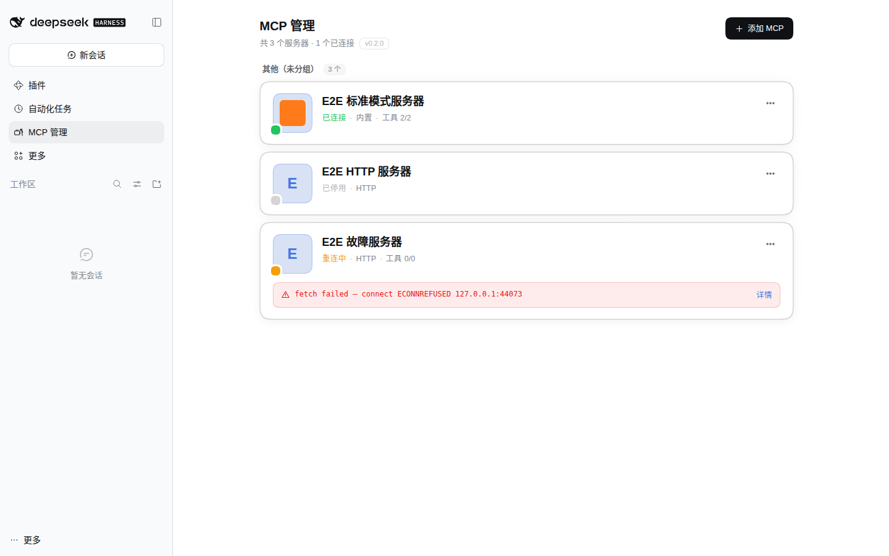
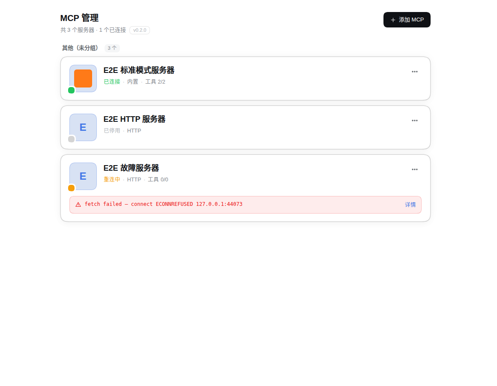
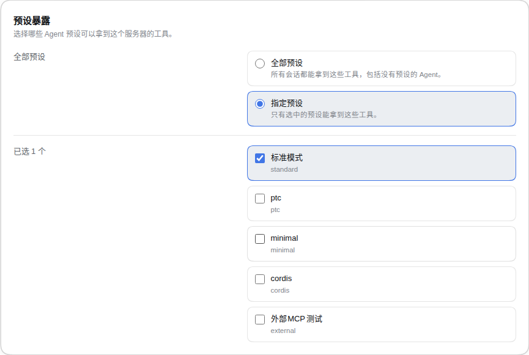
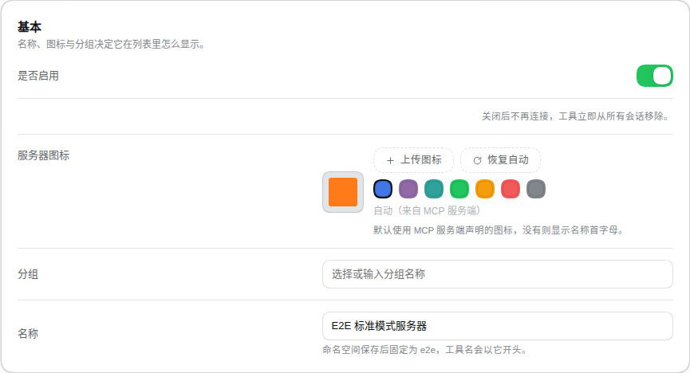

# 面向 DeepSeek Harness 的 MCP 管理

**MCP 管理 / MCP Manager** —— 在 DeepSeek Harness 的 Web 界面里管理 MCP 服务器，并按 Agent 预设
决定每个服务器的工具交给谁。

<p align="center">
  
</p>

<p>
  <a href="LICENSE"></a>
  <a href="README.md">English</a>
</p>

---

## 它是什么

DSH 本来就能使用外部 MCP 服务器提供的工具，方式是在 profile 里写 YAML 行。这个插件把这件事搬进
界面：侧边栏多出一个 **MCP 管理** 入口（就在 **自动化任务** 正下方），点开是整页的管理器。添加、
编辑、分组、启用、测试、删除 MCP 服务器都在这里；每台服务器是否已连接、用的哪种传输、有多少个工具、
失败原因是什么，也都写在卡片上。

它不只是个表单：**每台服务器可以自己决定把工具交给哪些 Agent 预设**。数据库 MCP 只给后端预设，
浏览器 MCP 只给研究预设，其余预设一个工具也拿不到——不用改预设 YAML，保存后立刻对运行中的 Agent
生效。

## 功能

- **整页管理器**，入口在侧边栏 **自动化任务** 正下方。圆角卡片、iOS 风格的开关与分段控件，
  深浅色主题都跟随 DSH。
- **增删改查 + 启用/停用**。停用的服务器保留全部设置和状态，点一下就能重新启用。
- **三种传输类型**：HTTP（Streamable HTTP）、SSE、内置（stdio，本机命令）。
- **自定义请求头**（HTTP/SSE），以及 **OAuth 设置**：不启用、静态 Bearer Token、客户端凭证模式。
- **图标与分组**：卡片显示 MCP 服务器自己声明的图标，没有就回退到名称首字，也可以用你上传的
  PNG/JPEG/WebP/GIF（≤512 KiB）——没有内置 emoji 调色板。列表按分组排列，未分组的排在最后，
  显示为 其他（未分组）。
- **实时连接状态**：已连接 / 连接中 / 重连中 / 连接失败 / 已停用，工具数量，失败时的错误气泡和
  **详情** 对话框（完整 message 与 detail）。
- **按服务器选择预设暴露**：全部预设，或指定预设（勾选 Host 提供的预设）。
- **测试连接**：不用保存就能先探一下草稿。
- **每台服务器单独的工具调用超时**，默认 60 秒。

<p align="center">
  
</p>

## 安装

插件是一个 DSH bundle，装进 Web profile：

```bash
dsh plugin --profile web add @ds-hu/dsh-better-mcp-manager
```

也可以用 Web 界面的插件管理页（Plugins 页 → 安装 bundle），或者让 Agent 用 `plugin_manager`
（`action: install_bundle`）代装。装完刷新页面；如果 profile 没开 HMR，需要重启 DSH Web 进程。
要求：DSH 0.2.x 的 Web profile，Node.js ≥ 20.19。

装好后，侧边栏会出现 **MCP 管理**，位置就在 **自动化任务** 正下方。它是全局页面：所有会话共用
同一份服务器列表（同一个 `$DSH_HOME` 下的 profile 也共用），不跟着会话走。

## 快速开始

### 1. 添加一个 HTTP MCP 服务器

点 **+ 添加 MCP**，传输类型保持 **HTTP**，填写：

- **名称**——自己认得就行，例如 `Docs search`；
- **服务器图标**——保持 **自动（来自 MCP 服务端）**，或使用 **上传图标** / **恢复自动**
  （见 [图标](#图标)）；
- **服务器地址**——MCP 端点，例如 `https://mcp.example.com/mcp`；
- **自定义请求头**——需要的话加 `Authorization` / `Bearer …`，或者改用 **OAuth 设置**；
- **预设暴露**——保持 **全部预设**，或勾选需要这些工具的预设。

可以先用 **测试连接** 探一下（不保存），再 **保存**。连接失败也照样保存：卡片上会写明原因，
服务器按退避策略继续重试。

### 2. 添加一个 stdio 服务器

传输类型切到 **内置**，填命令和参数：

- **命令**——`npx`；
- **参数**——`-y`、`@modelcontextprotocol/server-everything`（以你的 MCP 服务器文档为准）；
- **环境变量**——进程需要的变量；
- **工作目录**——留空表示沿用 Host 的目录。

这个命令会作为 DSH Host 的子进程运行，使用 Host 用户的权限和环境，再叠加你设置的环境变量。

### 3. 选择谁能拿到工具

每台服务器都有 **预设暴露** 一栏：

- **全部预设**——所有 Agent，包括没有预设 id 的 Agent；
- **指定预设**——只给勾选的预设。一个都不勾也是合法的，表示这台服务器不对任何 Agent 暴露。

<p align="center">
  
</p>

工具在 Agent 创建时注册；保存服务器或切换启用状态时，运行中的 Agent 会被重新绑定，所以不用重启
就能在已打开的会话里看到变化。还没开始第一轮对话的会话，在切换预设时会按新预设重新绑定。

对模型暴露的工具名是 `mcp__<key>__<工具名>`。`key` 在创建服务器时由名称生成一次，之后永不改变，
所以重命名服务器不会改工具名。

### 4. 看连接状态

页面打开时，卡片的状态行每 2.5 秒刷新一次：

```
已连接 · HTTP · 工具 19/19
连接失败 · HTTP · 工具 0
已停用 · SSE
```

连接失败时卡片显示错误的前两行，点 **详情** 看完整 message 和传输层的 detail。**重新连接** 会
立刻发起一次新的连接；**测试连接** 再探一次已保存的配置。

## 图标

服务器图标不是插件自带的图片：没有 emoji 调色板，也没有内置图标库。来源只有两个。

- **自动（默认）**：卡片使用 MCP 服务器在 `initialize` 结果里声明的第一个图标
  （`serverInfo.icons`，优先无主题或浅色主题的那个）。服务器没声明、图标取不到、或不是
  PNG/JPEG/WebP/GIF 时，卡片显示服务器名称的首字。HTTP(S) 图标由 DSH Host 带着这台服务器配置的
  请求头和 OAuth 去取（5 秒超时、512 KiB 上限），在内存里缓存 10 分钟——浏览器不会去取。
- **上传**：在服务器表单里，**服务器图标** → **上传图标** 选择本机的 PNG/JPEG/WebP/GIF，最大
  512 KiB；**恢复自动** 会删掉上传的图标，回到服务端声明的图标。上传的文件保存在
  `$DSH_HOME/better-mcp-manager/icons/`（见 [数据与安全](#数据与安全)），替换、恢复自动或删除
  服务器时都会删掉。不接受 SVG。

<p align="center">
  
</p>

## 数据与安全

- 插件的配置是一个 JSON 文件 `$DSH_HOME/better-mcp-manager/servers.json`（文件 `0600`，目录
  `0700`），上传的图标放在同目录的 `icons/` 子目录里（目录 `0700`，每个文件 `0600`）。它不往
  profile、预设 YAML 或会话目录写任何东西。挂载插件时会创建数据目录；保存第一台服务器后才出现
  JSON 文件。MCP 服务端声明的 HTTP 图标由 Host 取回、只缓存在内存里——不会写到磁盘。
- **密钥以明文保存在这个文件里**：自定义请求头的值、Bearer Token、客户端凭证的 secret。请保护
  这台机器和这个文件；不要把它提交到仓库、贴进 issue，或复制到共享主机。
- HTTP 接口挂在 Host 自己的 Web 服务器上，路径 `/better-mcp-manager/api`，仅限同源：所有写操作都
  校验 Origin，带请求体的调用要求 `Content-Type: application/json`，请求体上限 64 KiB——图标上传
  是例外，它的 JSON 信封最大 1 MiB，解码后的图片最多 512 KiB。没有额外端口，除了 DSH 自带的 Web
  认证之外没有别的认证。
- **上传的图标由 Host 原样返回**：带 `X-Content-Type-Options: nosniff` 和
  `Cache-Control: private, max-age=300`；SVG 会被拒绝，因为同源的 SVG 文档可以执行脚本。
- **内置服务器就是交给 DSH 去运行的程序**，只添加你信任的命令。HTTP 服务器会收到你配置的请求头
  和 Token，包括为它声明的图标 URL 发起的请求。

JSON 文件很小、可读；想连图标一起备份就复制整个目录，想彻底删掉就用下面的清理命令。

## 卸载

先移除 bundle，再删掉唯一的数据目录（服务器列表和上传的图标都在里面）：

```bash
# 1. 移除 bundle —— CLI、Plugins 页的 Remove，或 plugin_manager remove_bundle
dsh plugin --profile web remove @ds-hu/dsh-better-mcp-manager

# 2. 删除已保存的服务器（可选；想以后重装时恢复列表就跳过）
npx -y @ds-hu/dsh-better-mcp-manager clean --yes
```

从源码目录运行时，同一条命令是 `node bin/mcp-manager.mjs clean --yes`；等价的手工操作是
`rm -rf "$DSH_HOME/better-mcp-manager"`。移除命令会自己清掉依赖和 bundle 行，所以在 profile 里
不留东西：没有运行过安装脚本，也没有服务或定时器要清。只剩 `clean` 这一步，而且只是因为服务器
列表是留是删由你决定；它会把整个目录删掉，包括 `icons/`。卸载后刷新一下页面——还开着的旧页面会
记得那个已经失效的侧边栏入口，直到刷新为止。

`clean` **必须带 `--yes`**：不带就拒绝执行并以非零状态退出，误敲也不会删东西。它同样拒绝任何
名字不是 `better-mcp-manager` 的数据目录，删完会打印实际删掉的路径。
`node bin/mcp-manager.mjs status`（默认命令）显示存了什么（目录权限、schema、服务器列表、启用数量），
`node bin/mcp-manager.mjs path` 打印数据目录；这两条都只读。

## 兼容性与限制

- **只处理工具和服务器 instructions。** 0.2.0 不暴露 MCP resources、资源模板、prompt 模板和
  sampling。只有 resource 的服务器在这里没有可展示的内容。
- **每台启用的服务器只有一条连接**，由所有被暴露的 Agent 共用。工具按 Agent 预设注册，不按会话、
  也不按单个工具：某台服务器要么整套工具可用，要么整套不可用。
- **没有按工具启用/停用**，也没有按工具的预设规则。
- **OAuth 只支持 Bearer Token 与客户端凭证**。没有授权码 / PKCE 流程，所以需要浏览器交互登录的
  服务器在 0.2.0 里连不上。
- **不导入、不迁移 YAML 配置。** 通过内置 `@deepseek-ai/dsh-mcp-client` 行配置的 MCP 服务器照常
  工作；这个页面不显示它们，在这里删除任何东西也不会碰到它们。
- **HTTP/SSE 服务器必须从 DSH Host 可达**，不是从浏览器可达。URL 里的 `localhost` 指 Host 的
  localhost。
- **没有内置图标。** 图标只能来自 MCP 服务端声明或你自己的上传；没有 emoji 调色板、没有内置图标
  集，也不能填 emoji 字符串。
- **自动图标是尽力而为。** 服务器要在 `serverInfo.icons` 里声明；远程图标受 5 秒 / 512 KiB /
  PNG/JPEG/WebP/GIF 限制，否则卡片显示名称首字。
- **上传只支持栅格图。** PNG、JPEG、WebP、GIF，最大 512 KiB；SVG 会被拒绝。
- **第一轮对话开始后，预设就固定了。** 请在对话开始前选好预设；还没开始第一轮对话的空白会话
  在切换预设时，会按新预设重新绑定。
- 服务器列表按 `$DSH_HOME` 存放，不按 profile 隔离：同一个 DSH home 下的 profile 共用一份列表。
  需要独立列表就换一个 `$DSH_HOME`。

## 常见问题

| 现象 | 检查 |
|---|---|
| **连接失败**，错误指向网络 | 服务器在运行吗？从 DSH Host 能访问吗？URL 是 MCP 端点吗（通常以 `/mcp` 结尾）？HTTP 和 SSE 是两种传输，选服务器文档写的那个。 |
| **连接失败**，错误指向认证 | 服务器要的是请求头还是 OAuth？自定义 `Authorization` 请求头优先于 Bearer Token；客户端凭证的字段要和身份提供方一致。 |
| 内置服务器 **连接失败** | 命令在 Host 的 `PATH` 里吗？参数存在吗？看 **详情**：命令找不到、进程退出码都在 detail 里。 |
| 会话里看不到工具 | 服务器是 **已连接** 吗？会话的预设在这个服务器的 **指定预设** 里吗？会话是不是在添加服务器之前就开始了——再保存一次，或者新开会话让它重新绑定。 |
| 两台服务器的工具重名 | 公开工具名带有各自服务器的不可变 key。如果归一化后仍然撞名，说明两台服务器的原始工具名冲突了：删掉其中一台再重新添加（会分配新 key），或去掉冲突的工具。 |
| 卡片显示名称首字而不是服务器图标 | MCP 服务器没声明图标，或图标在 5 秒 / 512 KiB / 支持的格式内取不到。首字是文档里的回退；上传一个图标即可覆盖。 |
| 上传图标失败 | 只接受 PNG/JPEG/WebP/GIF，最大 512 KiB（不接受 SVG）；表单会在上传前校验并说明原因。 |
| 保存时返回 `403` | 反向代理改写了 `Host` 头会触发同源检查。让 DSH Web 端口保留浏览器发来的原始 `Host`。 |
| 页面空白但没有报错 | Host 半边没跑起来：确认 bundle 已启用，并访问 `GET /better-mcp-manager/api/health`。 |

## 文档

| 文档 | 内容 |
|---|---|
| [docs/TECHNICAL.md](docs/TECHNICAL.md) | 架构、图标模型、数据模型、HTTP 接口、安全、生命周期、卸载、测试 |
| [CONTEXT.md](CONTEXT.md) | 这个插件使用的术语与不变量 |
| [docs/adr](docs/adr) | 设计决策的来由 |
| [docs/API-CONTRACT.md](docs/API-CONTRACT.md) | 冻结的 Host/Client/数据契约 |

## 许可

MIT，见 [LICENSE](LICENSE)。第三方归属见 [NOTICE](NOTICE)。
